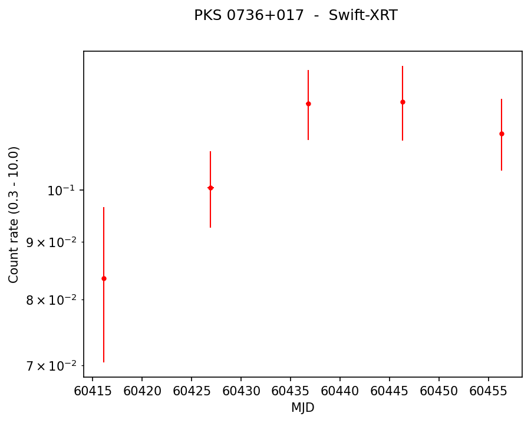

# SWIFT-XRT-ANALYSIS

**An easy, interactive Python tool for making *Swift*-XRT light curves and spectra.**

> 🔒 **The source code is available on request.** See [Requesting access](#requesting-access) below.

`xrt_products.py` uses the official
[UKSSDC XRT product builder](https://www.swift.ac.uk/user_objects/) Python API
(`swifttools`). It asks you a few simple questions (source name, what to make,
time range, binning, redshift). It then submits the job to the Leicester
server, waits for it to finish, and downloads ready-to-use results: light curves
(CSV and PNG), XSPEC-ready spectra and spectral-fit tables.

No HEASoft installation and no raw-data downloads are needed. The data
reduction (Evans et al. 2007, 2009) runs on the UKSSDC server.



---

## Features

- **Step-by-step questions.** Every input shows its *Format* and an *Example*.
  ENTER accepts the default, `?` gives help, and wrong inputs are explained and asked again.
- **Sources by name.** Coordinates are looked up automatically (SIMBAD/NED), and
  several sources can be processed in one run (`3C 279; PKS 0736+017`).
- **Data selection:** all data, a date range (`YYYY-MM-DD` or MJD), or a list of ObsIDs.
- **Light curves:** binned per snapshot, per ObsID, in fixed time bins or by counts.
  Soft/hard bands and hardness ratio, with the time axis in MJD or seconds.
- **Spectra:** one spectrum, one per ObsID or snapshot, or up to four user-defined time
  intervals. Fitted with XSPEC (power law / APEC / blackbody) including Galactic and
  intrinsic (redshifted) absorption.
- **Convenience:** the e-mail address is remembered, the job can be left running on the
  server, and earlier jobs can be downloaded later by job ID.

## Example session

```
What do you want to do?
   1) Make a new light curve / spectrum
   2) Download the results of a job I submitted earlier
   3) Quit

Source name(s).
   Format : name as known to SIMBAD/NED; separate several sources with ;
   Example: 3C 279      or      3C 279; PKS 0736+017
   > 3C 279; PKS 0736+017
   ✓ 3C 279:  RA = 194.04653°   Dec = -5.78931°
   ✓ PKS 0736+017:  RA = 114.82514°   Dec = +1.61795°
```

| Step | Input | Accepted format |
|------|-------|-----------------|
| 1 | Source name(s) | SIMBAD/NED name(s) separated by `;`; or `RA Dec` in degrees / `hh:mm:ss ±dd:mm:ss` |
| 2 | Products & data | light curve / spectrum / both; all data, two dates, or 11-digit ObsIDs |
| 3 | Details | light-curve binning; number of spectra; redshift of each source |
| 3 | *Advanced (optional)* | energy band, soft/hard split, detection threshold, T0, fit models, Galactic N<sub>H</sub>, time intervals |
| 4 | Summary | check everything, then submit |

## Output

For every source, the tool writes a folder `xrt_output/<source name>/` containing:

| File | Content |
|------|---------|
| `lightcurve.png` | light-curve plot |
| `lightcurve_*.csv` | count-rate light curves, soft/hard bands and hardness ratio |
| `spectral_fits.csv` | photon index, N<sub>H</sub>, observed and unabsorbed 0.3–10 keV flux (90 % errors), C-stat/dof |
| `spectrum/` | source and background `.pi`, `.arf`, `.rmf` files, ready for XSPEC, plus plots of the fits |

Example fit table ([`examples/PKS0736+017_spectral_fits.csv`](examples/PKS0736+017_spectral_fits.csv)):

```
spectrum          model      Gamma / kT          flux 0.3-10 keV (erg/cm2/s)        C-stat/dof
Obs_00036373015   PowerLaw   1.98 +0.35 -0.29    3.53e-12 +7.74e-13 -6.26e-13       90.4/120
Obs_00036373016   PowerLaw   1.58 +0.28 -0.17    5.28e-12 +8.56e-13 -8.82e-13       116.9/156
```

## Requirements

Python ≥ 3.8 with `swifttools`, `astropy` and `matplotlib`, and an e-mail address
registered (free) at <https://www.swift.ac.uk/user_objects/register.php>.

## Requesting access

The source code is kept in a private repository. To request access, e-mail
**[zahir.shah@manipal.edu](mailto:zahir.shah@manipal.edu?subject=Access%20request%3A%20SWIFT-XRT-ANALYSIS)**
with:

- your name and affiliation
- your intended use
- your GitHub username

You will then be given access to the code repository.

## Acknowledgement

Publications that use the products should acknowledge the UKSSDC and cite
Evans P. A. et al. 2007, A&A, 469, 379 and Evans P. A. et al. 2009, MNRAS, 397, 1177.

## Author

**Zahir Shah** · <https://shahzahir.github.io/>
